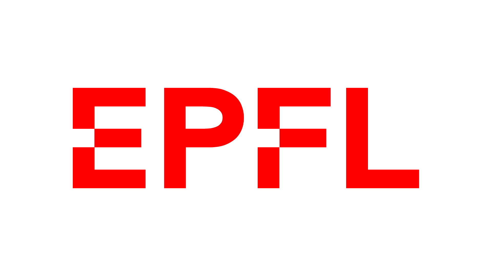

<div align="center">

</div>

<div align="center">
Ecole Polytechnique Fédérale de Lausanne
</div> 
<div align="center">
EE-559 - Deep Learning
</div> 

## Table of Contents

- [Repository Structure](#repository-structure)
- [Contributors](#contributors)

## Repository Structure

- data: this folder contains the datasets and outputs of the model
    - raw: contains the raw datasets
    - first-level: datasets with standardised columns ```text```, ```label``` and ```y```; 
    - second-level: datasets for which soft targets and logits have been pre-computed using a larger teacher model;
    - outputs: contains the outputs of the model

- src: main dev folder of the project

    - constants.py: contains general constants accessible throughout the project;
    - dataloader.py: contains data loading functions
    - main.py: file used to train the model
    - model.py: contains the model architecture as well as the structure of the dataset
    - soft_targets.py: file used to pre-generate the soft targets of the teacher model
    - utils.py: contains general utility functions

- config.yml: configuration file containing all parameters for the run. Here, one can determine what parameters to use for the run.

## Run the model

Run the file main.py to train the model. You can modify the different parameters you want to test in config.yml.


## Contributors
This repository has been elaborated by Caspar Henking, Aksel Acar and Niels Rigaud during the 2025 Spring Semester.